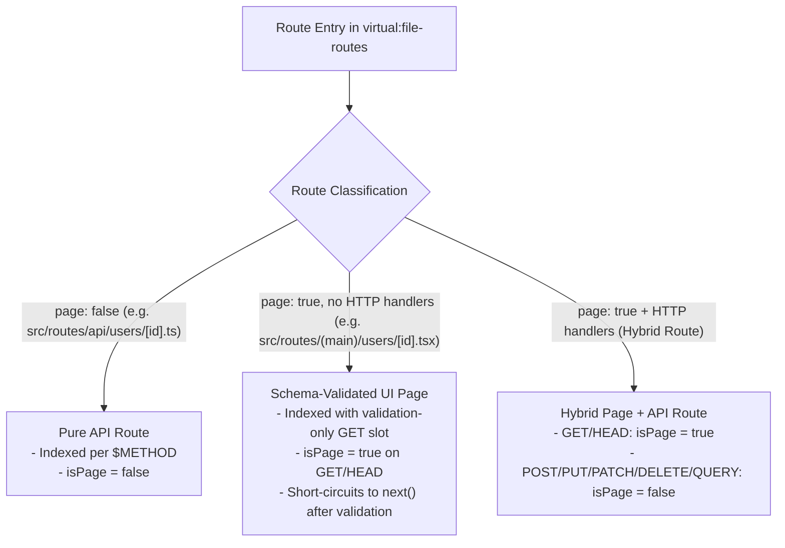

# Route Handlers and Middleware

TypedRoute allows you to define type-safe HTTP API handlers in `src/routes/api/` and dispatch them with automatic schema validation via `createMiddleware`.

---

## Defining Typed API Route Handlers (`route.handler`)

Use `route.handler((event) => ...)` to bind an HTTP method export (`GET`, `POST`, `PUT`, `PATCH`, `DELETE`, `HEAD`, `OPTIONS`, `QUERY`) to the route's `params` and `search` schemas:

```ts
// src/routes/api/users/[id].ts
import * as v from "valibot";
import { defineRoute } from "@skyjt/typed-routes-solid";

export const route = defineRoute({
  params: v.object({
    id: v.number(),
  }),
  search: v.object({
    includeMeta: v.optional(v.boolean(), false),
  }),
});

export const GET = route.handler((event) => {
  // event.params.id is inferred as `number`
  // event.search.includeMeta is inferred as `boolean`
  return Response.json({
    id: event.params.id,
    includeMeta: event.search.includeMeta,
  });
});

export const DELETE = route.handler((event) => {
  return Response.json({
    deletedId: event.params.id,
  });
});
```

> **Good to know**: `route.handler` types `event` as `TypedAPIEvent<TParams, TSearch>` automatically. You never need to import `APIEvent` from `filesystem-routing/api` or cast `event.params` / `event.search`.

---

## Configuring Server Middleware (`src/middleware.ts`)

Pass the default `routes` export from `"virtual:file-routes"` directly to `createMiddleware`:

```ts
// src/middleware.ts
import routes from "virtual:file-routes";
import { createMiddleware } from "@skyjt/typed-routes-solid";

export const apiMiddleware = createMiddleware(routes, {
  base: "/",
  onValidationError({ error, rawParams, rawSearch, isPage }) {
    // Allow UI page requests to proceed to SSR so the route's `errorComponent` renders
    if (isPage) {
      return;
    }

    // Return a structured 400 JSON error for API endpoints
    return Response.json(
      {
        success: false,
        error: "Route Validation Error",
        target: error.target,
        issues: error.issues,
        received: { params: rawParams, search: rawSearch },
      },
      { status: 400 },
    );
  },
});

export default apiMiddleware;
```

---

## How `isPage` Is Calculated in `createMiddleware`

Understanding how `createMiddleware` distinguishes between a **UI Page request** (`isPage: true`) and an **API Endpoint request** (`isPage: false`) is critical when customizing `onValidationError`:



### The `isPage` Formula

For any matched route and incoming HTTP `request.method`, `createMiddleware` computes `isPage` via its internal `MatchedRouteMetadata` registry:

$$\text{isPage} = (\text{route.page} === \text{true}) \land (\text{request.method} \in \{\text{"GET"}, \text{"HEAD"}\})$$

| Route Type | `route.page` | Request Method | `isPage` | Default Behavior on Validation Failure |
| :--- | :--- | :--- | :--- | :--- |
| **Pure API Route** (`src/routes/api/...`) | `false` | Any (`GET`, `POST`, `DELETE`, …) | `false` | Returns `400 Bad Request` JSON response (or custom `Response` returned by `onValidationError`). |
| **UI Page Route** (`src/routes/(main)/...`) | `true` | `GET` or `HEAD` | `true` | If `onValidationError` returns `void`, sets `event.validationError = error` and calls `next()` so Solid SSR renders the route's `errorComponent`. |
| **Hybrid Route** (`page: true` + `export const POST`) | `true` | `POST`, `PUT`, `PATCH`, `DELETE`, `QUERY` | `false` | Treated as an API mutation (`isPage: false`); returns `400 Bad Request` JSON on invalid input. |