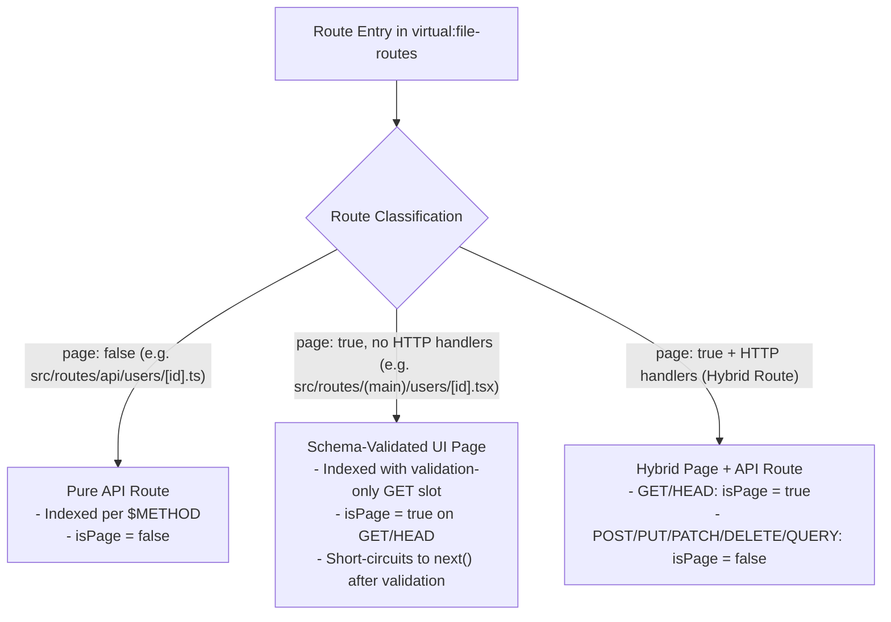

# Route Handlers and Middleware

TypedRoute allows you to define type-safe HTTP API handlers in `src/routes/api/` with per-method `body`, `headers`, `cookies`, `search`, and `responses` validation, composable middleware (`defineMiddleware` / `use`), typed response helpers (`json`, `text`, `noContent`, `redirect`), `HttpError` exception handling, and end-to-end RPC type inference.

---

## 1. Defining Typed API Route Handlers (`route.handler`)

`route.handler` supports two overloads:
- **1-Argument Overload (`route.handler(fn)`)**: Zero-allocation identity binding to the route's shared `params`, `search`, `headers`, and `cookies` schemas.
- **2-Argument Overload (`route.handler(config, fn)`)**: Scopes `body`, `headers`, `cookies`, `search`, `use` (middleware), and `responses` schemas to an individual HTTP verb (`GET`, `POST`, `PUT`, `PATCH`, `DELETE`, `HEAD`, `OPTIONS`, `QUERY`).

```ts
// src/routes/api/users/[id].ts
import * as v from "valibot";
import { defineRoute, HttpError, json, noContent } from "@skyjt/typed-routes-solid";

export const route = defineRoute({
  params: v.object({
    id: v.number(),
  }),
  search: v.object({
    includeMeta: v.optional(v.boolean(), false),
  }),
});

export const GET = route.handler((event) => {
  // event.params.id is inferred as `number`
  // event.search.includeMeta is inferred as `boolean`
  return json({
    id: event.params.id,
    includeMeta: event.search.includeMeta,
  });
});

export const PATCH = route.handler(
  {
    body: v.object({
      name: v.pipe(v.string(), v.nonEmpty()),
      role: v.picklist(["admin", "engineer", "operator"]),
    }),
    headers: v.object({
      "x-api-version": v.optional(v.number(), 1),
    }),
  },
  async (event) => {
    // event.body is `{ name: string; role: "admin" | "engineer" | "operator" }`
    // event.headers["x-api-version"] is `number`
    if (event.params.id === 0) {
      throw HttpError.notFound("User not found", { code: "USER_NOT_FOUND" });
    }
    return json({ id: event.params.id, updated: event.body }, 200);
  },
);

export const DELETE = route.handler(() => {
  return noContent();
});
```

> **Good to know**:
> - **Automatic Content-Type Body Decoding**: When `body` is configured on `route.handler(config, fn)`, `createMiddleware` automatically decodes `application/json`, `application/x-www-form-urlencoded`, `multipart/form-data`, `text/*`, and binary `ArrayBuffer` payloads. Malformed JSON returns a clean `400 Bad Request` validation error (`target: "body"`).
> - **Lowercase Header Keys**: Per the WHATWG Fetch `Headers` specification, incoming header names are normalized to lowercase (`"authorization"`, `"x-api-version"`). Always define header schema keys in lowercase.
> - **Sync-First Async Validation**: Both synchronous and asynchronous `StandardSchemaV1` / function validators are supported in `createMiddleware`. Synchronous schemas execute with zero `Promise` or microtask overhead.

---

## 2. Composable API Middleware (`defineMiddleware` & `use`)

Define reusable middlewares with `defineMiddleware` and attach them via `use: [...]` on either `defineRoute({ use })` (runs for all HTTP verbs in the route file) or `route.handler({ use }, fn)` (runs for that specific HTTP verb).

- **Return a plain object** ? Merged into `event.context` with full compile-time TypeScript inference (`MergeMiddlewareContext`).
- **Return a `Response` or throw `HttpError`** ? Short-circuits the pipeline immediately.
- **Return `void` / `undefined`** ? Continues execution without modifying `event.context`.

```ts
import { defineMiddleware, defineRoute, HttpError, json } from "@skyjt/typed-routes-solid";

export const requireAuth = defineMiddleware(async (event) => {
  const auth = event.request.headers.get("authorization");
  if (!auth?.startsWith("Bearer ")) {
    throw HttpError.unauthorized("Missing or invalid Bearer token");
  }
  return {
    currentUser: { id: 1, name: "Wriothesley", role: "admin" as const },
  };
});

export const route = defineRoute({});

export const GET = route.handler(
  {
    use: [requireAuth],
  },
  (event) => {
    // event.context.currentUser is strongly typed as `{ id: number; name: string; role: "admin" }`
    return json({ user: event.context.currentUser });
  },
);
```

---

## 3. Typed Response Helpers, `HttpError`, & RPC Type Inference

### Response Helpers & `HttpError`
- `json(data, statusOrInit?)`: Returns `TypedResponse<TData, TStatus>` (`application/json`).
- `text(data, statusOrInit?)`: Returns `TypedResponse<TText, TStatus>` (`text/plain; charset=utf-8`).
- `noContent(init?)`: Returns `TypedResponse<null, 204>`.
- `redirect(url, status?)`: Returns `TypedResponse<null, 301 | 302 | 303 | 307 | 308>`.
- `HttpError`: Throw `HttpError.badRequest()`, `HttpError.unauthorized()`, `HttpError.forbidden()`, `HttpError.notFound()`, `HttpError.conflict()`, `HttpError.unprocessable()`, `HttpError.internal()`, or `new HttpError(status, message, { code, details })`.

### End-to-End Compile-Time RPC Inference
Extract input and output contracts from any handler export with zero runtime bundle overhead:

```ts
import type {
  InferHandlerInput,
  InferHandlerOutput,
  InferHandlerData,
} from "@skyjt/typed-routes-solid";
import type { PATCH as UpdateUserPATCH } from "~/routes/api/users/[id]";

type PatchInput = InferHandlerInput<typeof UpdateUserPATCH>;
// { params: { id: number }; search: { includeMeta: boolean }; body: { name: string; role: ... }; headers: ...; cookies: ... }

type PatchOutput = InferHandlerOutput<typeof UpdateUserPATCH>;
// { status: 200; data: { id: number; updated: ... } }

type PatchData = InferHandlerData<typeof UpdateUserPATCH, 200>;
```

---

## 4. Configuring Server Middleware (`src/middleware.ts`)

Pass the default `routes` export from `"virtual:file-routes"` directly to `createMiddleware`:

```ts
// src/middleware.ts
import routes from "virtual:file-routes";
import { createMiddleware } from "@skyjt/typed-routes-solid";

export const apiMiddleware = createMiddleware(routes, {
  base: "/",
  onValidationError({ error, rawParams, rawSearch, rawBody, isPage }) {
    if (isPage) {
      return;
    }
    return Response.json(
      {
        success: false,
        error: "Route Validation Error",
        target: error.target,
        issues: error.issues,
        received: { params: rawParams, search: rawSearch, body: rawBody },
      },
      { status: 400 },
    );
  },
  onApiError({ error }) {
    return Response.json(
      {
        success: false,
        error: error.message,
        status: error.status,
        code: error.code,
        details: error.details,
      },
      { status: error.status },
    );
  },
});

export default apiMiddleware;
```

---

## 5. How `isPage` Is Calculated in `createMiddleware`



$$\text{isPage} = (\text{route.page} === \text{true}) \land (\text{request.method} \in \{\text{"GET"}, \text{"HEAD"}\})$$

| Route Type | `route.page` | Request Method | `isPage` | Default Behavior on Validation Failure |
| :--- | :--- | :--- | :--- | :--- |
| **Pure API Route** (`src/routes/api/...`) | `false` | Any (`GET`, `POST`, `DELETE`, etc.) | `false` | Returns `400 Bad Request` JSON response (or custom `Response` returned by `onValidationError`). |
| **UI Page Route** (`src/routes/(main)/...`) | `true` | `GET` or `HEAD` | `true` | If `onValidationError` returns `void`, sets `event.validationError = error` and calls `next()` so Solid SSR renders the page component with validation error tuples `[undefined, error]`. |
| **Hybrid Route** (`page: true` + `export const POST`) | `true` | `POST`, `PUT`, `PATCH`, `DELETE`, `QUERY` | `false` | Treated as an API mutation (`isPage: false`); returns `400 Bad Request` JSON on invalid input. |
